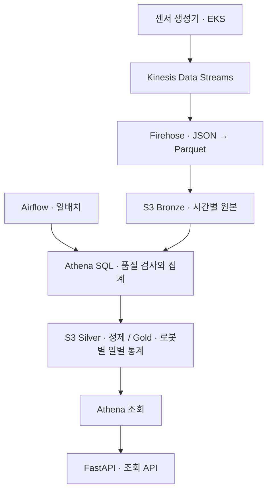

# Robot Data Platform

합성 센서 기록으로 로봇별 하루 최고 온도와 배터리 사용량, 이상 신호 횟수를 집계하는 개인 프로젝트입니다. Terraform으로 AWS 네트워크와 EKS를 구성하고, 센서 생성기와 조회 API를 Docker 이미지로 만들어 ECR에 올린 뒤 EKS에 배포했습니다. [인프라 구성](docs/public/ARCHITECTURE.md) · [배포 워크플로](.github/workflows/k8s-deploy.yml)

## AWS에서 확인한 결과

- **8월 24일 · Kinesis 수신 41,000건.** 초당 약 100건을 보낸 뒤 S3에 Parquet 파일이 생긴 것을 확인했습니다. Firehose 버퍼가 모두 비워지기 전 Athena에서 조회한 구간은 로봇 100대의 29,391행입니다. [수집·저장 지표](docs/public/RELIABILITY.md#2026-08-24-전체-파이프라인-short-lived-aws-증거)
- **8월 25일 · 센서 원본 2,965행 → 로봇 10대의 일별 통계 10행.** 별도 배치 시험에서 Airflow 일배치와 같은 조건의 SQL을 Athena에서 직접 실행했습니다. 정제 후 2,965행을 확인하고 로봇별로 집계했습니다. [배치 집계 기록](https://jungseongheon.org/portfolio/evidence/robot-batch-20260825.json)
- **9월 3일 · 사설 RDS 재실행 후 고유 4건 유지.** Glue Spark로 검사한 정상 4건을 다시 반영해도 건수가 같았습니다. 정상 1건에 배터리 값이 120인 행을 섞은 배치는 전체를 차단해 신규 반영 0건이었습니다. [정상 배치·재실행](docs/public/evidence/2026-09-03-migration-success.json) · [오류 배치](docs/public/evidence/2026-09-03-migration-reject.json)

## 아키텍처

Kinesis에서는 로봇 ID로 이벤트를 나눠 받습니다. S3에는 Firehose가 시간별로 묶어 저장합니다. 로봇마다 작은 파일이 생기는 일을 줄이고, 조회할 시간대만 골라 읽기 위해서입니다. 자정(KST)에 실행하도록 구성한 Airflow 일배치에서 Athena SQL로 원본을 검사하고 로봇 ID·측정 시각이 같은 기록을 정리합니다. [일배치 코드](dags/robot_daily_etl.py) · [포트폴리오 상세](https://jungseongheon.org/portfolio/#robot)



- **수집과 저장 사이의 지연**은 CloudWatch로 따로 확인합니다. 8월 24일 수집 구간에서 Kinesis 쓰기 제한은 0건이었고 Firehose의 S3 전달 신선도는 306~312초였습니다. [신뢰성 기록](docs/public/RELIABILITY.md)
- **분석 조회**에는 Glue Data Catalog의 스키마와 Athena Partition Projection을 사용합니다. API는 수집이 늦은 날 최근 데이터가 있는 파티션을 선택해 캐시를 갱신합니다. [조회 설계](docs/public/ARCHITECTURE.md)
- **사설 RDS 이관**은 별도의 배치 경로입니다. S3 Parquet를 Glue Spark로 검사해 staging에 넣고, 한 트랜잭션으로 최종 테이블에 반영합니다. 입력 오류는 S3와 감사 테이블에 남깁니다. [이관 설계](docs/public/S3-GLUE-RDS-LAB.md) · [행 검사](src/migration/s3_to_rds_contract.py) · [Glue 작업](jobs/glue/s3_to_rds.py) · [최종 반영 코드](jobs/glue/promote_batch.py) · [계약 테스트](tests/migration/test_s3_to_rds_contract.py)

## PRISM 오프라인 데모

같은 저장소의 **PRISM**은 공구 교체나 속도 조정 같은 대응 방안을 비교하는 팀 시제품입니다. DuckDB와 저장된 모델 응답을 사용해 노트북에서 의사결정 화면을 재현할 수 있습니다. [데이터·예측 인터페이스](docs/public/INTERFACE.md)

```bash
cd prism
cp .env.example .env
docker compose up --build
```

| URL | 화면 |
|---|---|
| <http://localhost:8501> | 결정론적 cache-replay 데모 |
| <http://localhost:8502> | Bedrock live 모드 |
| <http://localhost:8503> | operator-first 콘솔 |

- 실행 상세: [`prism/README.md`](prism/README.md)
- 운영자 시나리오: [`prism/operator-guide.md`](prism/operator-guide.md)

## 검증

```bash
make setup
make lint
make test
make infra-check
```

지원 Python은 `.python-version`의 3.11로 고정합니다. PR과 `main` push에서는 같은 명령으로 critical Python lint, deterministic core tests, Terraform format/validate를 실행합니다.

Airflow 2.10.5 DAG contract는 별도 CI job에서 검증하고, AWS 의존 E2E는 수동 실행 계층으로 분리합니다. 비용이 드는 production 검증을 로컬 core test와 동일한 증거로 표현하지 않습니다.

## 비용 최소화 검증 경로

스트리밍 데이터 계약과 freshness/lag SLO만 확인할 때는 전체 EKS 플랫폼을 만들지 않고 [`terraform/validation`](terraform/validation)을 사용합니다. 이 프로필은 Kinesis 2 shards, Firehose 1개, S3/Glue/CloudWatch만 만들며, 기존 전체 plan 104개 대비 14개 리소스로 줄였습니다. EKS worker·NAT Gateway·ALB·RDS·SageMaker·Slack/Lambda는 생성하지 않습니다.

저비용 프로필의 기본값은 Kinesis 24시간 보존, Firehose `64MB/60초`, S3 증거 1일 보존입니다. Parquet 변환을 유지하려면 Firehose 버퍼가 64MB 이상이어야 하므로 크기는 더 낮추지 않고 flush interval을 300초에서 60초로 줄였습니다. 100Hz 중심 4시간 검증은 약 `$1~$3`, 1,000Hz를 4시간 연속 전송하는 경우는 데이터량에 따라 약 `$4~$6`으로 추정합니다. 수치는 리전·데이터 크기·실행 시간에 따라 달라지는 사전 모델이며, 실제 실행 뒤 apply/destroy 시간과 함께 기록합니다.

실제 CDN 비용 없이 멀티리전·멀티CDN 장애 전환 정책을 연습하려면 [`docs/public/EDGE-FAILOVER-LAB.md`](docs/public/EDGE-FAILOVER-LAB.md)의 결정론적 lab을 실행합니다. 주 리전 장애 후 2초 failover RTO와 `cdn-a → cdn-b` 전환을 재현하지만, 실제 라이브 미디어/CDN 운영 증거로 확대하지 않습니다.

실제 HLS·CloudFront·Cloudflare 경로까지 짧게 검증하려면 [`docs/public/MEDIA-LAB.md`](docs/public/MEDIA-LAB.md)를 사용합니다. 두 리전 private S3와 CloudFront OAC, Cloudflare Worker primary/fallback 경로를 만들고 HLS playlist·segment 및 controlled failover를 측정한 뒤 Worker와 AWS 리소스를 모두 teardown합니다.

## 계정 이식성과 배포 안전 게이트

- K8s·Helm·Athena 배포 원본에는 AWS 계정 ID, 리전, 버킷, 이미지 태그를 고정하지 않습니다. `scripts/render_deployment.py`가 검증된 비밀 아닌 좌표만 별도 디렉터리에 렌더링하며 원본은 수정하지 않습니다.
- GitHub Actions는 OIDC 세션의 STS identity로 계정을 확인하고, 컨테이너 이미지를 Git commit SHA로만 배포합니다. `latest` 태그는 workload 계약에서 금지합니다.
- 배포 전 GitHub Repository Variables에 `AWS_ACCOUNT_ID`, `AWS_REGION`, `EKS_CLUSTER_NAME`, `S3_BUCKET_NAME`을 등록합니다. 실제 STS account가 `AWS_ACCOUNT_ID`와 다르면 배포는 렌더링 전에 종료됩니다.
- 로컬에서 AWS를 변경하는 셋업 스크립트는 명시한 계정과 실제 STS account가 일치해야 진행합니다. 장기 access key는 입력 계약에 포함하지 않습니다.
- Airflow 관리자 비밀번호는 Helm values에 두지 않습니다. `/robot-telemetry/airflow-admin-password`를 Secrets Manager에 만든 뒤 `scripts/sync_airflow_admin_secret.sh`로 Kubernetes Secret을 먼저 동기화해야 하며, 스크립트는 STS account 일치 여부를 Secret 조회 전에 검사합니다.
- Terraform CI는 현재 `fmt/init -backend=false/validate`까지만 허용합니다. 새 계정의 remote state, state locking, OIDC trust를 bootstrap하기 전에는 plan/apply를 배포 증거로 주장하지 않습니다.

```bash
cp .env.example .env
RENDER_ROOT="$(mktemp -d /tmp/robot-deploy.XXXXXX)"
AWS_ACCOUNT_ID=123456789012 \
AWS_REGION=ap-northeast-2 \
EKS_CLUSTER_NAME=robot-telemetry-cluster \
S3_BUCKET_NAME=globally-unique-bucket \
IMAGE_TAG="$(git rev-parse HEAD)" \
python3 scripts/render_deployment.py --output "$RENDER_ROOT"

# Airflow를 처음 설치하기 전에 namespace와 bootstrap Secret을 준비
bash scripts/sync_airflow_admin_secret.sh
```

## 운영 기록

- 품질 검사와 재처리 기준, Glue 작업을 사설 RDS에 연결하면서 겪은 오류. [판단 기록](docs/public/data-engineering-log.md) · [트러블슈팅](docs/public/troubleshooting.md) · [이관 재현 순서](docs/public/lessonrun.md) · [실행 기록 해석](docs/public/evidence/README.md)
- Flink의 이상 신호 탐지는 AWS Studio Notebook에서 관리합니다. 8월 24일 시험은 Kinesis 수집과 S3 전달 구간을 대상으로 했습니다. [탐지 규칙과 검증 방법](docs/public/FLINK-ANOMALY-CONTRACT.md)
- 전체 Terraform 환경은 비용 승인을 거쳐 실행합니다. 기본값은 `allow_full_stack_apply=false`입니다. [비용 추정과 환경 선택 기준](docs/public/COST-ESTIMATE.md)
- 관련 데이터 프로젝트. [ASK Seoul 예보 품질·공간 데이터](https://github.com/masondev1024/seoul-weather-platform/blob/main/docs/architecture/forecast-quality-spatial-product.md) · [D2C Kafka 이벤트의 Iceberg 적재](https://github.com/masondev1024/d2c-event-data-platform/blob/main/lakehouse/d2c_iceberg_stream.py)

## 저장소 구조

```text
apps/             Streamlit PRISM/operator 콘솔
src/orchestration PRISM causal DAG, agents, data/predictor contracts
src/generator     KDS telemetry producer와 demo CNC stream
src/api           FastAPI portal
src/ml            local/SageMaker predictors와 training
terraform/        AWS 인프라 및 data_pipeline 모듈
k8s/, helm/       EKS workloads, autoscaling, observability, Airflow
dags/, sql/       idempotent batch DAGs와 Athena DDL
grafana/          운영 대시보드 5종
tests/, evals/    unit/smoke/e2e 및 LLM 품질 평가
```

## 현재 범위와 한계

- Managed Flink 코드는 AWS Studio Notebook을 운영 원본으로 사용하므로 이 저장소에는 배포 가능한 Flink 소스가 없습니다.
- 이상치 탐지 계약과 Studio Notebook black-box 검증 방법은 [docs/public/FLINK-ANOMALY-CONTRACT.md](docs/public/FLINK-ANOMALY-CONTRACT.md)에 정리되어 있습니다.
- production AWS E2E는 인프라가 켜진 주기에만 수행합니다.
- CNC telemetry는 demo 전용이며 production `AthenaDataSource`에서 의도적으로 지원하지 않습니다.
- 이 저장소는 포트폴리오 환경을 위한 단일 계정/리전 설계입니다. 다중 계정 landing zone과 조직 단위 정책은 다음 확장 범위입니다.

## 데이터와 라이선스

시연 데이터는 [AI4I 2020 Predictive Maintenance Dataset](https://archive.ics.uci.edu/dataset/601/ai4i+2020+predictive+maintenance+dataset) (CC BY 4.0)을 사용합니다. 원본 전체 데이터와 런타임 DuckDB 파일, 자격증명은 커밋하지 않습니다.
