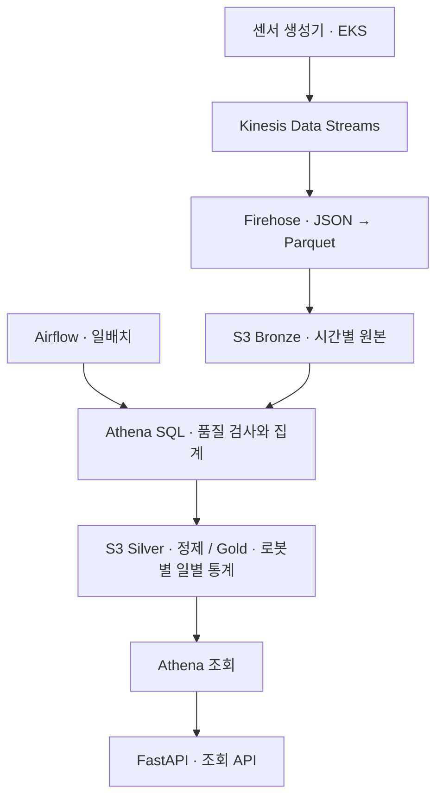

# Robot Data Platform

로봇마다 하루 최고 모터 온도는 몇 도였고, 이상 신호는 몇 번 나왔을까? 가상의 센서 데이터를 AWS에 모아 이 두 값을 SQL로 구하는 개인 프로젝트입니다.

Terraform으로 AWS 네트워크와 EKS를 구성했습니다. 센서 생성기와 조회 API는 각각 Docker 이미지로 만들어 ECR에 올리고 EKS에 배포했습니다. [AWS 구성](docs/public/ARCHITECTURE.md) · [배포 워크플로](.github/workflows/k8s-deploy.yml)

## AWS에서 돌려 본 결과

**8월 24일 · 센서 수집**  
Kinesis가 초당 약 100건, 총 **41,000건**을 받았습니다. 같은 시험에서 Athena로 S3를 조회했을 때 보인 건 로봇 100대의 **29,391행**이었습니다. 이때는 Firehose가 아직 S3에 파일을 쓰는 중이었습니다. Kinesis 쓰기 제한은 0건이었고, CloudWatch에서 본 S3 전달 지연은 306~312초였습니다. [당시 지표와 조회 시간](docs/public/RELIABILITY.md#2026-08-24-전체-파이프라인-short-lived-aws-증거)

**8월 25일 · 하루 통계**  
다음 날에는 로봇 10대의 데이터로 따로 배치를 점검했습니다. Airflow 일배치와 같은 조건의 SQL을 Athena에서 직접 실행하니 원본 **2,965행**이 정제 후에도 그대로 남았고, 일별 통계에는 **로봇 한 대당 한 행씩 총 10행**이 들어갔습니다. [원본·정제·집계 건수](https://jungseongheon.org/portfolio/evidence/robot-batch-20260825.json)

**9월 3일 · 중복과 잘못된 값**  
센서 기록 4건을 RDS에 넣고 마지막 저장 단계를 한 번 더 실행해도 테이블에는 4건만 남았습니다. 그다음에는 정상 기록 1건과 배터리 잔량이 120인 기록 1건을 함께 넣었습니다. 이번에는 검사에서 배치가 멈췄고, 최종 테이블에 추가된 행은 0건이었습니다. [재실행 결과](docs/public/evidence/2026-09-03-migration-success.json) · [오류가 섞인 배치 결과](docs/public/evidence/2026-09-03-migration-reject.json)

## 센서 기록 한 건이 일별 통계가 되기까지



센서 생성기는 `robot_id`를 키로 Kinesis에 보냅니다. S3에 쓸 때는 로봇별로 나누면 작은 파일이 많이 생겨서, Firehose가 같은 시간대의 기록을 Parquet 파일로 묶도록 했습니다. Athena는 Glue Data Catalog의 스키마와 파티션 프로젝션(Partition Projection)을 사용해 조회할 시간대의 S3 경로를 찾습니다. [저장·조회 설계](docs/public/ARCHITECTURE.md)

Airflow 일배치는 한국 시간 자정에 시작하도록 구성했습니다. 먼저 원본의 온도와 배터리 잔량 등을 검사합니다. 정제 단계에서는 `robot_id`와 측정 시각이 같은 기록을 하나만 남기고, 집계 단계에서는 로봇별 최고 온도, 하루 최고·최저 배터리 잔량의 차이, 이상 조건에 해당한 기록 수를 구합니다. [일배치 코드](dags/robot_daily_etl.py) · [포트폴리오](https://jungseongheon.org/portfolio/#robot)

테스트 환경을 꺼 둔 날은 전날 통계가 없어 조회 API가 빈 결과를 돌려준 적이 있습니다. 지금은 최근 7일 안에 통계가 있는 가장 늦은 날짜를 찾아 그 결과로 캐시를 갱신합니다. Kinesis 수신은 정상인데 S3 적재가 멈췄을 때 어떤 지표를 봤는지도 정리했습니다. [조회 오류와 적재 지연 기록](docs/public/RELIABILITY.md)

### S3 원본을 RDS로 옮기는 경우

RDS 이관은 일별 통계와 별도로 만들었습니다. Glue Spark가 S3 원본을 검사한 뒤 임시 테이블에 쓰고, 최종 반영은 한 트랜잭션에서 처리합니다. 오류가 섞인 배치를 나중에 다시 살펴볼 수 있도록 거부한 행은 S3에, 이유와 건수는 감사 테이블에 남깁니다. [이관 설계](docs/public/S3-GLUE-RDS-LAB.md) · [행 검사](src/migration/s3_to_rds_contract.py) · [Glue 작업](jobs/glue/s3_to_rds.py) · [최종 반영 코드](jobs/glue/promote_batch.py) · [검사 규칙 테스트](tests/migration/test_s3_to_rds_contract.py)

## 로컬에서 실행하기

### PRISM 데모

이 저장소에는 팀 프로젝트로 만든 **PRISM**도 있습니다. 공구를 교체할지, 회전 속도를 낮출지 같은 선택지를 비교하는 화면입니다. 기본 데모는 DuckDB와 미리 저장한 모델 응답을 사용하므로 노트북에서 같은 사례를 다시 볼 수 있습니다. CNC 센서 데이터는 이 데모에서만 사용합니다. [데이터와 예측 모델 연결 방식](docs/public/INTERFACE.md)

```bash
cd prism
cp .env.example .env
docker compose up --build
```

| 주소 | 볼 수 있는 화면 |
|---|---|
| <http://localhost:8501> | 저장된 응답으로 같은 시나리오 재생 |
| <http://localhost:8502> | Amazon Bedrock에 직접 연결하는 모드 |
| <http://localhost:8503> | 운영자가 설비 상태와 대응 방안을 보는 콘솔 |

[PRISM 실행 방법](prism/README.md) · [운영자 시나리오](prism/operator-guide.md)

### 코드와 인프라 설정 검사

저장소 루트에서 Python 3.11(`.python-version`)과 Terraform으로 실행합니다.

```bash
make setup
make lint
make test
make infra-check
```

PR을 열거나 `main`에 변경을 올리면 GitHub Actions가 Python 오류, 핵심 테스트, Terraform 설정을 검사합니다. Airflow DAG와 작업 간 데이터 전달은 Airflow 2.10.5를 설치한 별도 작업에서 검사합니다. AWS 서비스 사이에 데이터가 실제로 오가는지는 테스트 환경을 켜고 수동으로 점검합니다.

## AWS 환경에서 실행하기

수집과 S3 적재만 시험할 때는 `terraform/validation`을 사용합니다. Kinesis 샤드 2개, Firehose 1개와 저장·조회·모니터링에 필요한 S3, Glue, CloudWatch를 구성합니다. 당시 Terraform 계획에서 생성 대상은 이 구성이 14개, EKS와 NAT Gateway 등을 포함한 전체 환경이 104개였습니다. 전체 환경은 비용을 검토한 뒤에만 켜도록 `allow_full_stack_apply=false`를 기본값으로 뒀습니다. [수집 테스트용 Terraform](terraform/validation) · [환경별 비용 계산](docs/public/COST-ESTIMATE.md)

수집 테스트용 구성에서는 Kinesis 보존 기간을 24시간, S3 테스트 파일 보존 기간을 1일로 설정했습니다. Parquet 변환에 필요한 Firehose 최소 버퍼 크기가 64MB여서 크기는 64MB로 두고, 전송 간격을 300초에서 60초로 줄였습니다. 당시 리전과 데이터 크기를 기준으로 예상한 4시간 비용은 초당 100건부터 1,000건까지 단계적으로 보낼 때 약 1~3달러, 처음부터 초당 1,000건을 계속 보낼 때 약 4~6달러였습니다. 

### 배포 설정

로봇 데이터 파이프라인은 AWS 계정 하나와 리전 하나에서 테스트했습니다. 배포할 때는 GitHub 저장소 변수에 `AWS_ACCOUNT_ID`, `AWS_REGION`, `EKS_CLUSTER_NAME`, `S3_BUCKET_NAME`을 지정합니다. GitHub Actions는 OIDC로 인증한 계정이 지정한 계정과 같은지 먼저 검사합니다. 이미지 태그에는 배포한 코드 버전을 찾을 수 있도록 Git 커밋 SHA를 씁니다.

아래는 예시 값으로 Kubernetes·Helm·Athena 설정 파일을 임시 디렉터리에 만드는 명령입니다.

```bash
cp .env.example .env
RENDER_ROOT="$(mktemp -d /tmp/robot-deploy.XXXXXX)"
AWS_ACCOUNT_ID=123456789012 \
AWS_REGION=ap-northeast-2 \
EKS_CLUSTER_NAME=robot-telemetry-cluster \
S3_BUCKET_NAME=globally-unique-bucket \
IMAGE_TAG="$(git rev-parse HEAD)" \
python3 scripts/render_deployment.py --output "$RENDER_ROOT"
```

Airflow를 처음 설치할 때는 `.env`에 실제 계정과 리전을 지정하고 AWS Secrets Manager에 `/robot-telemetry/airflow-admin-password`를 준비합니다. 아래 스크립트는 현재 AWS 계정을 검사한 뒤 Kubernetes에 네임스페이스와 관리자 Secret을 만듭니다. 로컬 설정 스크립트도 지정한 계정과 AWS STS가 반환한 계정이 같을 때만 AWS 리소스를 변경합니다.

```bash
bash scripts/sync_airflow_admin_secret.sh
```

Terraform CI는 `fmt`, `init -backend=false`, `validate`까지 실행합니다. 새 계정에 배포하려면 Terraform 원격 상태 저장소와 잠금, GitHub OIDC 신뢰 설정을 먼저 준비해야 합니다.

## 작업하면서 남긴 기록

- 어떤 행을 제외할지 정한 과정과 Glue가 사설 RDS에 연결되지 않았을 때 살펴본 설정을 정리했습니다. [품질 검사와 재처리](docs/public/data-engineering-log.md) · [연결 오류 기록](docs/public/troubleshooting.md) · [이관 재현 순서](docs/public/lessonrun.md) · [실행 기록 읽는 법](docs/public/evidence/README.md)
- Flink 이상 탐지는 AWS Studio Notebook에서 관리합니다. 8월 24일에 실제로 따라간 범위는 Kinesis에서 S3까지입니다. 저장소에는 탐지 조건과 Notebook을 켠 뒤 알림을 시험하는 절차가 있습니다. [Flink 탐지 규칙](docs/public/FLINK-ANOMALY-CONTRACT.md)
- CDN 장애 전환은 별도 실습입니다. 로컬 시뮬레이션에서는 주 리전 장애를 넣은 뒤 2초 만에 `cdn-a`에서 `cdn-b`로 전환됐습니다. 두 리전의 비공개 S3, CloudFront OAC, Cloudflare Worker로 HLS 재생 목록과 영상 조각을 요청하고 실습 자원을 정리하는 절차도 기록했습니다. [로컬 장애 전환](docs/public/EDGE-FAILOVER-LAB.md) · [HLS 실습](docs/public/MEDIA-LAB.md)

## 저장소 구조

```text
src/generator/      로봇 센서 기록 생성과 Kinesis 전송
terraform/          AWS 인프라와 수집 테스트용 구성
k8s/, helm/         EKS 배포 설정과 Airflow
dags/, sql/         일배치와 Athena 테이블 정의
src/api/            FastAPI 조회 API
grafana/            수집·적재 상태 대시보드
apps/               PRISM 시연 화면과 운영자 콘솔
src/orchestration/  PRISM의 대응 방안 비교와 데이터·모델 인터페이스
src/ml/             로컬·SageMaker 예측 모델과 학습 코드
tests/, evals/      기능 테스트와 모델 응답 평가
```

PRISM 시연에는 CC BY 4.0으로 공개된 AI4I 2020 예지정비 데이터를 사용했습니다. [데이터 원본과 라이선스](https://archive.ics.uci.edu/dataset/601/ai4i+2020+predictive+maintenance+dataset)

다른 데이터 프로젝트도 살펴볼 수 있습니다. [ASK Seoul 예보 품질과 공간 데이터](https://github.com/masondev1024/seoul-weather-platform/blob/main/docs/architecture/forecast-quality-spatial-product.md) · [D2C Kafka 이벤트의 Iceberg 적재](https://github.com/masondev1024/d2c-event-data-platform/blob/main/lakehouse/d2c_iceberg_stream.py)
